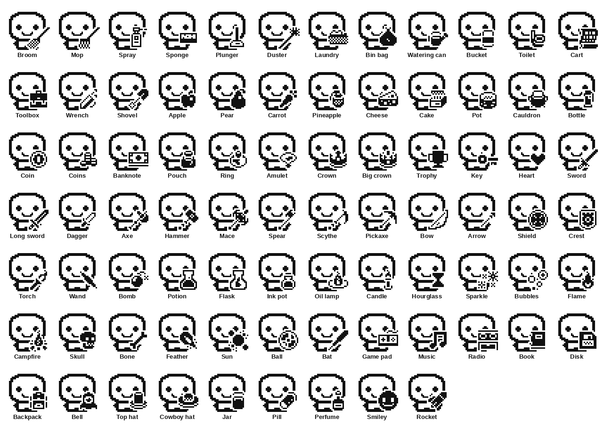

# Things to hold (RoomiePet)

A Pet can hold something in its hand: a broom, a mop or a spray for the chores, food, treasure, a sword, a wand, a
game pad... Each is a 16 × 16 one-colour picture, drawn over the Pet's lower right with a white edge so it reads
against whatever is under it (and under the pin, which stays readable).



Most of the pictures are from **Kenney's [1-Bit Pack](https://kenney.nl/assets/1-bit-pack)** (CC0: free for any use;
credit is kind, not required): 1,078 pictures drawn for one-colour screens, which suits the X4's e-ink. The chore
tools Kenney doesn't have (broom, mop, spray, sponge, plunger, duster, laundry basket, bin bag) are drawn in the
same style, in `catalog/sprites/`.

## Adding things, the easy ways

**From the web app** (the X4's **Items** tab, on a phone over its WiFi or on a computer over USB), no new firmware:

- **From Kenney's pack:** the whole sheet is there; tap a picture, name it, *Add to the X4*.
- **Your own picture:** pick any image; it's cropped to what's drawn, shrunk to 16 × 16 and made black and white
  (transparent or white is paper). Simple shapes with thick lines work best.

The X4 keeps what it's given on its SD card (`/pet/items.bin`, up to 96) and **passes it on over the radio**: whenever
it syncs with roommates (House, Sync) or meets other Pets (Pet, hold B), each device says a digest of its catalog in
its hello; while two differ, each sends its things one radio message at a time (about 55 bytes each, the ones it was
given first), and each keeps the ones it didn't have. So one roommate adds a thing, and the whole house has it after
the next Sync. A Pet holding something your X4 doesn't have yet shows it as soon as it arrives.

**In the firmware** (for everyone, from the next release): one line in `catalog/items.txt`, then one command.

```text
Teapot, kenney:770            # a tile of Kenney's pack: its number (the web app's Items tab shows the sheet)
Mop bucket, mopbucket.png     # or a 16 x 16 PNG in catalog/sprites/
```

```sh
python3 tools/items/build.py   # writes src/apps/pet/items.h, site/x4/items.js and site/x4/kenney.png
```

CI fails if those are out of date (`--check`).

## How it works

- `src/apps/pet/items_logic.h`: an item (an id, a name of up to 12 characters, the picture), the catalog (the
  firmware's, then the ones given), the radio message, and drawing it in a Pet's hand. Checked on a computer by
  `tools/itemtest`.
- An item's **id** is the CRC-32 of its name and picture, kept to 24 bits: the same thing added on two X4s gets the
  same id, and a damaged radio message can't add a broken item (the id must match). What a Pet holds is saved and
  sent as that id: in Meet's hello, in friends lists, and on the household member card (above the pride flag).
- `src/apps/pet/held.cpp`: the X4's catalog on the SD card, the sharing, and the USB commands the web app uses:

| Command | What |
|---|---|
| `I LIST` | Every item: `IT <id> <name hex> <picture hex> <0 firmware / 1 given>`, then `OK I LIST <count> <digest>` |
| `I ADD <name hex> <picture hex>` | Adds one (the X4 works out its id): `OK I ADD <id>` |
| `I DEL <id>` | Removes one it was given (X4s it was passed to keep theirs) |
| `P SET ... <held id>` | What the Pet holds (`P GET` says it) |

The Waveshare board (unidex) has no catalog and holds nothing.
